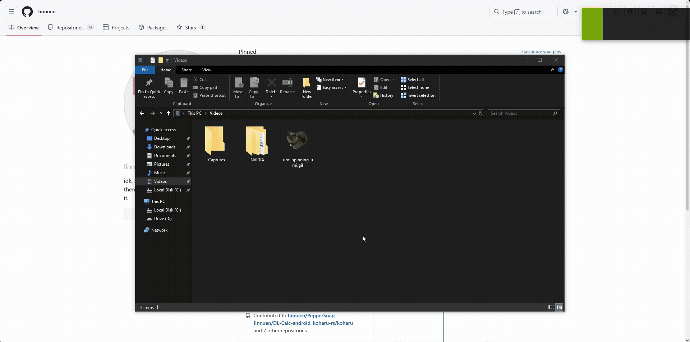
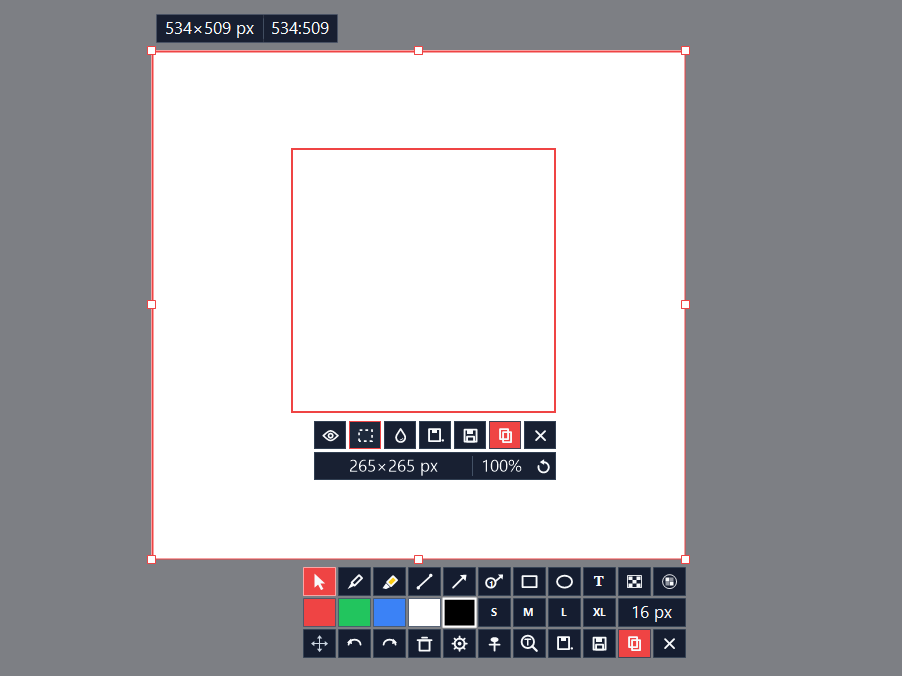

# 🌶️ PepperSnap

**A fast, lightweight screenshot tool for Windows that lives in your system tray.**
Capture any part of your screen, mark it up, pin it on top of your desktop, copy text out of it, or search it on the web — all with a single keystroke.

One small portable `.exe`. No installer. No account. Nothing to configure before you start.

---

## 🚀 Get started

1. Grab the latest `PepperSnap_v4.x.x.exe` from the [Releases](https://github.com/finnuen/PepperSnap/releases) page — the file name carries its version.
2. Run it. PepperSnap appears in your system tray.
3. Press **Ctrl + Print Screen** (or left-click the tray icon) and start capturing.

> 💡 Right-click the tray icon and open **Keyboard shortcuts and info**. It's a searchable guide to everything PepperSnap can do, and it's full of tricks you'd otherwise miss.

> 🔐 **Admin permission.** PepperSnap runs with admin permission so shortcuts and capture keep working while an app running as administrator has focus — without it, a shortcut pressed over such a window silently does nothing. Windows therefore asks for that permission, with the usual UAC prompt, every time PepperSnap starts. Nothing is installed to save you that prompt: no scheduled task, no service, and no system setting beyond the per-user startup entry listed under features. If you decline the prompt, or your account has no admin permission, PepperSnap simply runs without it. One launch never prompts: if PepperSnap is already running, starting it again — or using its right-click entries — just hands the request to the copy already in the tray. To never run elevated at all, start it with the `--noelevate` switch or set `RunElevated=0` in `settings.ini`.

---

---

## ⌨️ Default hotkeys

Every shortcut can be changed in **Options → Customize keys**.

| Hotkey | What it does |
|---|---|
| **Ctrl + Print Screen** | Capture a custom area, then annotate it |
| **Shift + Print Screen** | Instantly capture and save all monitors |
| **Ctrl + Shift + Print Screen** | Instantly re-capture and save your previous area |
| **Alt + Print Screen** | Search the image in your clipboard on Google Lens |
| **Shift + Alt + Print Screen** | Pin the image from your clipboard on top of the desktop |
| **Ctrl + Alt + Print Screen** | Edit the image in your clipboard |

---

## ✨ Features

### 📸 Capture exactly what you want
- **Custom area** with pixel-precise aiming and a magnifier. Use the arrow keys to nudge by one pixel.
- **Window detection.** Hold **Ctrl** and click to snap to any window, notification pop-up or sidebar.
- **Instant fullscreen** across all your monitors, saved straight to your folder.
- **Repeat your last capture** with one hotkey. It remembers the exact shape, too.
- **Non-rectangular captures.** Draw circles and ellipses (hold **Alt**), or drag corners to reshape the area into a quadrilateral or triangle.
- **Aspect ratio shortcuts.** Lock to 1:1, 16:9, 9:16, 1:2 or 2:1 while dragging, or type any width, height or ratio you like.
- **Color picker.** Hold **Shift** and click to copy the hex code of any pixel on screen.
- **Optional cursor capture** if you want the mouse pointer in your screenshots.

### ✏️ Annotate right on the screen
- **Pen** and **Stabilo highlighter**, with optional smoothing so your strokes look clean.
- **Lines, arrows, rectangles and ellipses.** Hold **Shift** for straight 15° angles and perfect squares or circles.
- **Numbered step arrows** for tutorials and bug reports, with a one-click counter reset.
- **Text boxes** you type directly onto the image, in Calibri Light with an automatic glyph outline so the words read over any background.
- **Mosaic / pixelate** (square or circle) to hide sensitive information.
- **Select mode.** Move, resize, recolor or delete any annotation, individually or several at once.
- A one-click red swatch, S / M / L / XL sizes and an exact pixel size box.
- Full **undo / redo**.

### 📌 Pin screenshots on top
- Pin any capture as a floating, always-on-top window. Handy for references, designs, notes or chat snippets.
- **Pin as many as you like.** New pins tile automatically so they don't overlap.
- **Scroll to resize**, drag to move, snap to screen edges, and type an exact size or zoom percentage.
- **Multi-select** pinned images and move or control them together. Hold **Shift** to apply any action to all of them.
- Pin an image straight from the **clipboard**, or from a file via Explorer.
- Plays **animated GIF and WebP** files and keeps transparency intact.

### 🔤 Copy text from any image
- **Extract text with OCR** from any area of your screen. It uses Windows' built-in text recognition, so there's nothing extra to install.
- The text goes straight to your clipboard, and can optionally be saved as a `.txt` file.

### 🔍 Search by image
- Copy any capture or pinned image and search it on Google Lens with the **Search on web** button in the toolbar.
- **Translate on web** sits left of Search on web on the custom area toolbar and opens Google Translate's image view instead of Lens. Pick the target language under Options; it starts out English. On a pinned image, **Shift + click Copy** takes every pinned image at once.

### 🖼️ Edit existing images
- Right-click any image in Explorer for:
  - **Edit with PepperSnap** to annotate it
  - **Pin on top** (works on several images at once)
  - **Search image on web**
- **Animated GIF and multi-frame WebP editor** with a scrollable frame strip and play / pause.

### 💾 Saving, your way
- Save as **PNG, JPEG, WebP or BMP**, with a JPEG quality slider.
- Set a different default format for copying, custom-area captures and fullscreen captures.
- **Custom file naming** with a live preview. Use tokens like date, time and a running counter.
- Choose to also save when you copy, auto-save pinned images, or keep the editor open after saving.
- **Save as** dialog whenever you want to pick the spot yourself.

### ⚙️ Made to fit your workflow
- **Rebind any shortcut**: global hotkeys, drawing tools, editor actions and pinned-image controls.
- **Launch at Windows startup** (optional) — starts it in the tray when you log on. With admin permission on, logging on shows the UAC prompt.
- **Automatic update checks** (daily to monthly, or off) through GitHub releases.
- **Restore everything to default** at any time.
- Your settings live in a plain `settings.ini` file in `%appdata%\PepperSnap`, so they're easy to back up or move to another PC.

---

## 🖥️ Requirements

- Windows 10 or 11 (64-bit)
- OCR needs a Windows language pack with text recognition installed (most setups already have one)

## 🔒 Privacy

PepperSnap runs entirely on your PC. The only network activity is an optional check for new releases on GitHub, which you can turn off in Options. Your screenshots are never uploaded anywhere. The "Search on web" feature simply opens Google Lens in your own browser, and "Translate on web" opens Google Translate the same way.

## 📄 License

[Apache License 2.0](LICENSE) — do whatever you like with it.

---

Enjoy! If you find a bug or have an idea, please open an issue. 🌶️
